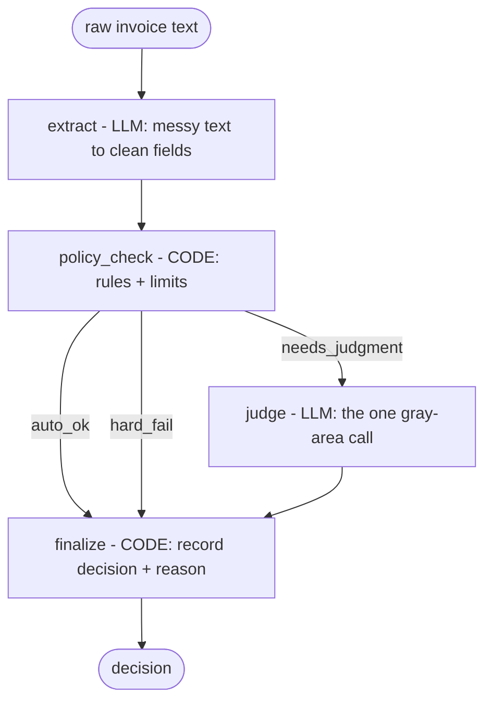

# Invoice Approval Agent

A beginner-friendly but genuinely realistic AI agent that reads a messy invoice, checks it against spending policy, uses an LLM only for the calls that actually need judgment, and either auto-approves it or escalates it to a human.

Built with Python, [LangGraph](https://github.com/langchain-ai/langgraph), and the free [Groq](https://console.groq.com) API. The whole thing lives in one Jupyter notebook, built cell by cell with the reasoning explained at every step.

## Why this one

Most "build an AI agent" tutorials hand you a chatbot that answers questions. This isn't that. This is the pattern that AP automation tools like Ramp, Brex, and SAP Concur run on: an invoice hits an automated layer, most of them are handled without a human, and only the genuinely ambiguous ones get a person's attention. Same shape as production, smaller scope.

The point of the project is one idea that most tutorials skip: **an agent is mostly boring, reliable code, with the LLM used surgically at the two or three spots where judgment can't be written as a rule.** You do not ask a language model whether 420 is less than 500. You ask it whether a $380 client dinner for six people is reasonable. Everything else is deterministic Python.

## How it works

The agent is a small graph. Work happens in nodes; routing happens on the edges between them.



The LLM appears in exactly two nodes: `extract`, because reading messy human text is something code is bad at, and `judge`, because "is this reasonable?" has no clean rule. Everything else is deterministic: the policy check, the routing, the final record.

### The decision logic

`policy_check` applies plain rules and labels each invoice with a route:

| Condition | Route | What happens |
|---|---|---|
| Missing vendor, or unreadable amount | `hard_fail` | Escalated to a human |
| Amount over the hard ceiling ($5,000) | `hard_fail` | Escalated to a human, no matter the category |
| Amount within the category's auto-approve limit | `auto_ok` | Approved by policy, no LLM call |
| Over the limit but under the ceiling | `needs_judgment` | Sent to the LLM judge |

Auto-approve limits live in a plain dict, so you can change policy without touching the logic. The `other` category is set to 0, which means anything the extractor couldn't confidently classify always gets at least a judgment call rather than a silent approval.

## Stack

- **Python** 3.10+
- **LangGraph** for the agent graph (state, nodes, edges, the control loop)
- **langchain-groq** as the model client
- **Groq** free API, model `openai/gpt-oss-120b`, for the two LLM steps
- **Pydantic** for typed, schema-constrained extraction

## Getting started

### 1. Get a free Groq API key

Sign in at [console.groq.com](https://console.groq.com), open **API Keys**, and create one. The free tier is enough to run this.

### 2. Install

```bash
python -m venv .venv
source .venv/bin/activate      # on Windows: .venv\Scripts\activate
pip install -r requirements.txt
```

### 3. Run the notebook

```bash
jupyter lab invoice_agent.ipynb
```

Run the cells top to bottom. The notebook will prompt you for your Groq key with `getpass` (it is never hardcoded or saved to the file). The last cell runs three sample invoices, one down each path, so you can watch the agent behave three different ways.

## Project structure

```
.
├── invoice_agent.ipynb   # the whole agent, built cell by cell with explanations
├── requirements.txt      # pinned, tested dependencies
└── README.md
```

## A note on versions

The LLM space moves fast and tutorials rot. The model name is kept in a single `MODEL` constant so swapping it is a one-line change, and the dependencies in `requirements.txt` are pinned to the exact versions this was tested against (October 2026). If you hit a "model not found" error from Groq, a model was almost certainly retired; check the live list at [console.groq.com](https://console.groq.com) and update the constant.

## Roadmap

- **v2:** human-in-the-loop with LangGraph's `interrupt()` and a checkpointer, so an escalated invoice can pause, sit in an approval queue, and resume when a person approves it.
- Richer policy (per-department budgets, duplicate detection).
- A durable checkpointer (SQLite/Postgres) and a real approvals queue.

## License

MIT. Use it, learn from it, ship something better.
